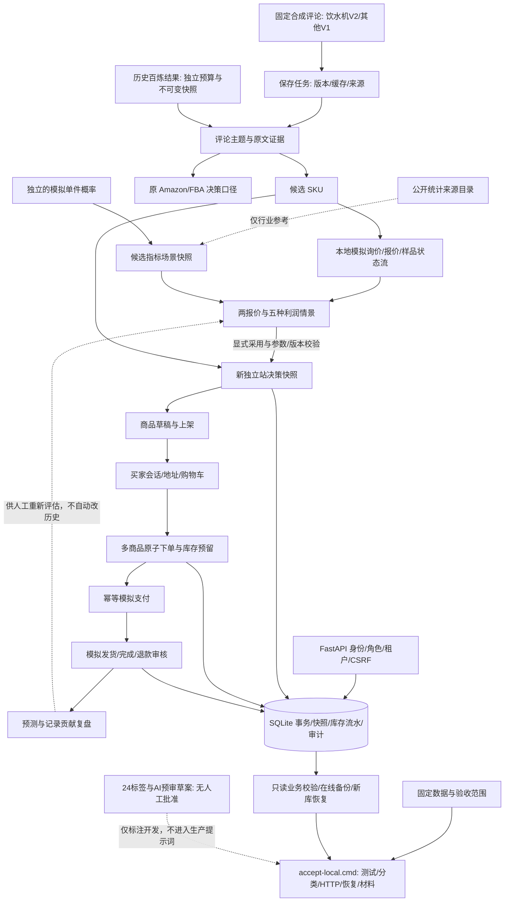

# 五分钟演示与实现架构

这是单商家、US/USD 的个人演示项目。以评论证据为起点，比较模拟采购方案和成本压力，再追踪到商品、订单与预测偏差。供应商、支付、物流和业务成本全部模拟；公开统计是独立的行业参考，不能冒充项目实测。

2026-11-26的[统一验收](evidence/local-acceptance-20261126.json)已完成五段检查，包含真实本机HTTP六行模拟订单和备份恢复；1051项测试通过，原7件在售商品保持。此结果可作为演示准备证据，仍不代表公开生产上线或真实业务收益。

## 启动与准备

在项目根目录执行 `.\local-commerce.cmd deploy`，统一打开 http://127.0.0.1:8031/workbench 与 http://127.0.0.1:8031/shop。数据库schema26；8027备用开发环境不参与本次演示。默认配置仅面向本机，卖家鉴权关闭并有页面提示。

演示前执行 `.\accept-local.cmd`，打开其输出目录中的report.txt核对五段验收。该命令会创建虚构交易记录、下架新测试商品并受控重启，演示期间不要同时运行。报告注明六品类支持范围和低质量基线，不把合成数据回归当作真实准确率。

若数据库没有演示商品，执行 scripts/seed_commerce.py；容器需在容器内执行同名脚本。种子不会覆盖已有密码或重置库存。演示前打开工作台和 /shop，使用虚构数据，不填真实个人资料。

若仅演示报价压力算例，可在本机虚拟环境执行 scripts/commerce_comparison_demo.py：它使用独立临时数据库，不改变演示站。详细算例见 PROFIT-COMPARISON-VALIDATION.md。下表金额为固定虚构输入的计算，须保持相同费用策略，不能作为实际采购报价或收益。

## 五分钟主线

| 时间 | 操作与讲解 | 观察证据 |
|---|---|---|
| 0:00–0:40 | 选 pet_fountain，分析评论，选择痛点并创建新候选 SKU | 查看原文证据；明确是构造评论，痛点不是需求证明 |
| 0:40–1:25 | 在该候选分别创建常规与延期模拟询价，依次模拟发出询价、返回报价 | ¥70/MOQ100/14天 与 ¥90/MOQ200/30天；事件标 simulation |
| 1:25–2:00 | 选模拟单品退货概率，输入每次退货损失 2000 分并保存，显式采用得到售后 200 分 | 来源是虚构 10% 假设；公开销售占比仍独立参考，不能被采用为单件成本 |
| 2:00–2:50 | 设售价3000、汇率7、物流500、支付300基点+30、获客300，风险选演示已检查；选择两报价，压力输入2500/6/800，保存比较 | 基线 $8.80/$5.94，综合压力 -$0.72/-$4.05；MOQ批量货值单独展示，未自动接受或采购 |
| 2:50–3:30 | 采用 A 基线，保存一次新决策，展开来源；生成草稿、入库并上架 | 比较、售后和公开来源同时留存；如修改参数仍保留引用，服务端拒绝；压力 NO_GO 无法生成草稿 |
| 3:30–4:25 | 在商城用虚构买家登录、加购、结算并模拟支付，返回卖家物流填550分、模拟发货和完成 | 库存预留与释放；支付重复触发不重复扣库存；没有真实资金或物流请求 |
| 4:25–5:00 | 展示复盘和业务一致性，沿订单明细追踪原决策 | 单件预测880分、记录830分、差额-50分；历史来源不会随着新报价或情景变化 |

工作台默认进入经营概览；通过左侧“评论分析”选择离线保存任务，确认宠物饮水机标记offline-rules-v2，再从保存主题创建候选。系统会进入“选品与成本”；保存决策后进入“商品与库存”。订单处理与买家售后都在“订单与售后”，预测差异在“经营复盘”。手机使用顶部“业务导航”。真实模型旧结果可查看，当前两份额度均已用尽；演示不勾选真实重新分析。其他五类保留V1，不能仅因能下单就宣称选品分析效果通过真实验证。24标签与50单元AI预审候选只在本地标注流程展示，不进入线上抽取。

需要展示售后时，在主线之后使用已有买家退款申请、卖家审核和四项净损失登记。未完整登记时利润显示待补全，未知不当作零。主线不依赖真实服务商或凭证。

## 架构与数据流

单体内保留领域模块边界：commerce 处理金额与交易规则，supplier_simulation 仅做本地状态流，business_metrics/metric_scenarios 管理来源与用途，profit_comparisons 做固定数量情景计算与显式引用。HTTP 层通过同一个身份依赖验证权限；关键写入与审计同事务提交。

SQLite BEGIN IMMEDIATE 与条件更新用于防超卖；幂等键用于抵御网络重试；报价版本用于发现过期操作；各阶段快照用于解释当时的计算。用途不同，不能互相替代。当前数据库适用于个人演示和单实例范围，尚未报告生产负载基线。

## 简历呈现

可写：个人实现跨境选品与独立站交易闭环，将评论证据、两报价敏感性分析及版本化成本决策追溯至商品与订单；使用事务、幂等、权限校验和来源快照处理并发重试与历史解释，供应商及交易执行采用可重放模拟。

面试重点讲清三件事：为什么销售额退货占比不能直接变成 SKU 退货概率；为什么商品和订单保存当时快照；为什么 MOQ/交期不能仅凭单件利润自动决定采购。

完整简历条目见 COMMERCE-PORTFOLIO.md。测试总量含继承用例，不作为本轮新增数量；没有真实 GMV、转化率、线上 QPS 或模型收益可报告。

统一HTTP验收另覆盖六品类同时下单：同一订单六行，按pending→paid→shipped→completed→refunded逐状态核对双方；重复结算/支付、跨买家访问、库存、逐行来源和贡献复盘均有机器检查。此路径创建的六个测试商品最终下架，旧商城目录保留；与上面的五分钟演示采用同一业务接口。
